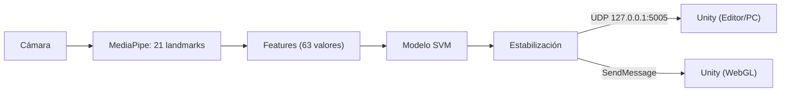

# LANDMARKS — Videojuego 2D controlado con gestos de mano

# AUTORES: JOHAN LATORRE / ABIGAIL VARGAS

Videojuego 2D hecho en **Unity** que se controla con la mano frente a la cámara. Un modelo de aprendizaje automático clasifica los gestos a partir de los *landmarks* de **MediaPipe** y envía la orden al juego en tiempo real. El proyecto funciona en dos modos:

- **Editor de Unity:** un script de Python reconoce los gestos y los envía por **UDP** a Unity.
- **Web (WebGL):** todo corre en el navegador. MediaPipe (JavaScript) y el mismo modelo exportado a **ONNX** reconocen los gestos y se los pasan a Unity con `SendMessage`. No requiere Python ni servidor.

> 🎮 **Juega la demo en itch.io:** [elrealbrr.itch.io/landmarks-project](https://elrealbrr.itch.io/landmarks-project)
>
> Requiere una cámara web. El video se procesa en tu navegador y no se envía a ningún servidor.

## Gestos reconocidos

| Gesto | Etiqueta | Uso en el juego |
|---|---|---|
| Puño | `REPOSO` | Personaje quieto |
| Mano inclinada a la derecha | `DERECHA` | Caminar a la derecha |
| Mano inclinada a la izquierda | `IZQUIERDA` | Caminar a la izquierda |
| Palma abierta | `PALMA` | Gesto de combate |
| Dos dedos | `DOS_DEDOS` | Gesto de combate |
| Un dedo | `UN_DEDO` | Gesto de combate |
| Sin mano / baja confianza | `NINGUNO` | Sin acción |

El teclado (A/D o flechas) funciona como respaldo en exploración, útil para depurar o si no hay cámara.

## Cómo funciona



1. **Landmarks:** MediaPipe detecta una mano y devuelve 21 puntos (x, y, z).
2. **Features:** se restan las coordenadas de la muñeca, se divide entre la distancia muñeca–base del dedo medio (landmark 9) y se aplanan en un vector de **63 valores**. Así el modelo no depende de la posición ni del tamaño de la mano en la imagen. La imagen se usa **en espejo** (como una selfie).
3. **Clasificación:** un clasificador de scikit-learn devuelve probabilidades por gesto.
4. **Estabilización** (evita parpadeos):
   - confianza mínima de **0.70**;
   - **3 fotogramas** seguidos para activar un gesto y **2** para volver a `REPOSO`/`NINGUNO`;
   - se reenvía el gesto cada **100 ms** y Unity vuelve a `NINGUNO` si pasan **0.5 s** sin mensajes.
5. **Entrega a Unity:** `GestureReceiver.cs` expone `CurrentGesture`, que leen `PlayerController2D` y el resto del juego.

### Modelo

`train_model.py` entrena y compara tres clasificadores (RandomForest, SVM con RBF y MLP) y guarda el de mejor F1 macro. El resultado del último entrenamiento fue **SVM**. Detalles del entrenamiento:

- Separación train/test **por sesión** (`GroupShuffleSplit`), para medir cómo generaliza a sesiones nuevas y no solo a fotogramas parecidos.
- **Aumento de datos:** espejo (intercambiando `DERECHA` ↔ `IZQUIERDA`) y ruido gaussiano.
- Exportación a ONNX con `export_onnx.py`, verificada contra scikit-learn (diferencia máxima de probabilidades ≈ 7·10⁻⁶ y 100% de coincidencia de clase).

### Datos

`data/landmarks.csv` tiene una fila por muestra con las columnas `label`, `session`, `f0 … f62`. Las muestras se graban cada 50 ms con `collect_data.py`.

| Clase | Muestras |
|---|---|
| `REPOSO` | — |
| `DERECHA` | — |
| `IZQUIERDA` | — |
| `PALMA` | — |
| `DOS_DEDOS` | — |
| `UN_DEDO` | — |

Sesiones grabadas: —  ·  F1 macro en test: —

## Estructura del repositorio

```
Landmarks-Project/
├── Game/                          Proyecto de Unity
│   └── Assets/
│       ├── Scripts/               GestureReceiver, PlayerController2D, BattleManager,
│       │                          BattleTrigger, SequenceDisplay...
│       └── WebGLTemplates/
│           └── GestureTemplate/   Plantilla WebGL con cámara y gestos
│               ├── index.html
│               ├── gesture_test.html   Prueba del modelo sin Unity
│               └── gesture/
│                   ├── gestures.js          MediaPipe + ONNX + estabilización
│                   ├── gesture_model.onnx
│                   ├── classes.json
│                   └── parity_sample.json
└── Model/                         Parte de Python
    ├── collect_data.py            Grabación del dataset
    ├── train_model.py             Entrenamiento y comparación de modelos
    ├── export_onnx.py             Exportación a ONNX (para la versión web)
    ├── gesture_udp.py             Reconocimiento en vivo -> Unity por UDP
    ├── landmark_utils.py          Cálculo de features (compartido)
    ├── test_realtime.py           Prueba del modelo en una ventana
    ├── udp_listener_test.py       Verifica que llegan los mensajes UDP
    ├── requirements.txt
    ├── data/                      Dataset (landmarks.csv)
    └── model/                     Modelos entrenados y exportados
```

## Requisitos

- **Unity** 6 (o la versión que uses: [indicar]) con módulo de build **WebGL**.
- **Python** 3.12 con las dependencias de `Model/requirements.txt` (entre ellas `mediapipe`, `opencv-python`, `scikit-learn`, `joblib`, `pandas`, `numpy`).
- Para exportar a ONNX: `pip install skl2onnx onnxruntime`.
- Una cámara web.

## Uso

### A. Jugar en el Editor / PC (UDP)

```bash
cd Model
pip install -r requirements.txt
python gesture_udp.py        # abre la cámara y envía el gesto a udp://127.0.0.1:5005
```

Con ese script corriendo, abre `Game/` en Unity y pulsa Play. `udp_listener_test.py` sirve para comprobar que los mensajes llegan.

### B. Reentrenar el modelo con tus propios datos

```bash
cd Model
python collect_data.py       # teclas 1-6 para grabar cada gesto, p pausa, q salir
python train_model.py        # compara modelos y guarda model/gesture_model.joblib
python export_onnx.py        # genera .onnx, classes.json y parity_sample.json
```

Graba **varias sesiones** (otra hora, luz, distancia o persona): con menos de 3 sesiones la precisión medida es optimista. Copia los tres archivos generados a `Game/Assets/WebGLTemplates/GestureTemplate/gesture/`.

### C. Compilar y probar la versión web (WebGL)

1. En Unity: *Player Settings → Resolution and Presentation → WebGL Template → `GestureTemplate`*.
2. *Publishing Settings → Compression Format: Disabled* (para pruebas locales).
3. Compila a una carpeta **fuera de `Assets/`** (por ejemplo `WebBuild/`).
4. Sirve esa carpeta y ábrela en el navegador:
   ```bash
   cd WebBuild
   python -m http.server 8000   # abre http://localhost:8000
   ```
5. Pulsa **Iniciar** y permite el acceso a la cámara.

Para verificar el modelo en el navegador sin Unity, sirve la carpeta de la plantilla y abre `gesture_test.html`. Debe mostrar `PARIDAD OK`.

### Publicación

La demo publicada está en [itch.io](https://elrealbrr.itch.io/landmarks-project). Para subir una versión nueva, comprime el **contenido** de la carpeta del build (con `index.html` en la raíz del ZIP) y súbelo como proyecto HTML5. La cámara solo funciona en **HTTPS** (o `localhost`); también sirven GitHub Pages, Netlify o Vercel. Si activas compresión Brotli/Gzip en Unity, el servidor debe enviar los encabezados `Content-Encoding` correctos (o usa *Decompression Fallback*).

## Notas y limitaciones

- La versión web usa `@mediapipe/tasks-vision` y el entrenamiento en Python usa la API clásica `mp.solutions.hands`. Sus landmarks son muy parecidos pero no idénticos. Si la precisión web cae, graba sesiones adicionales y reentrena.
- El orden de las clases del modelo es **alfabético** (el de scikit-learn), no el de la lista del código. Por eso se exporta `classes.json` junto al `.onnx`.
- Si tras instalar `skl2onnx` falla `mediapipe` por conflicto de `protobuf`, ejecuta `pip install "protobuf>=4.25.3,<5"`.
- Solo se reconoce **una mano** a la vez.

## Tecnologías

Unity (C#) · MediaPipe (Python y `@mediapipe/tasks-vision`) · scikit-learn · ONNX / `onnxruntime-web` · OpenCV · WebGL
